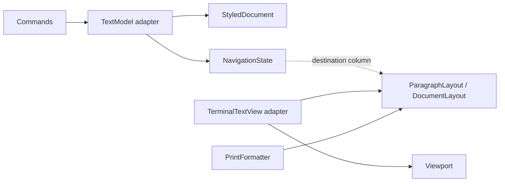

# Editor core contracts

The editor has four pure components, with no terminal, clipboard, settings, or
file I/O dependencies. `TextModel` and `TerminalTextView` adapt these components
to the existing application API. Core values are immutable; cached layout data
cannot be changed by consumers.



## Coordinates and layout

`coordinates.py` distinguishes source offsets (Python codepoints), terminal cell
columns, document content lines, and screen rows. `DocumentPosition` identifies
a paragraph and a codepoint boundary. Paragraph separators have no style mask.

`layout.py` defines wrapping and the mappings between these coordinates:

- Each `LayoutLine` records its source range, rendered text, source index for
  each rendered codepoint, and canonical caret stops.
- Synthetic hanging indentation has no source index. Both rendered hyphens of
  an em dash share its source index and style. Screen and print style runs use
  this mapping; selection ranges convert it to terminal cell columns.
- A consumed wrap separator belongs to the preceding line. Its caret may sit
  in the right margin. Hard-wrap boundaries belong to the following line.
  A paragraph that exactly fills its last line has an empty continuation row.
- Vertical targeting chooses the first canonical stop at or after the desired
  cell column, or the last stop on a shorter row. Combining display units can
  have several source offsets at the same cell; round trips are canonical,
  not necessarily identical for every source offset.

Terminal painters consume these decisions without wrapping the caret again.
Legacy `render_paragraph` and mapper imports remain available through `view.py`;
their mutable list results are copies of immutable layout values.

## Viewport geometry

`viewport.py` represents every visible row as `TextRow` or `PageBreakRow`.
A page marker is never inferred from document text and cannot hold the caret.
The top is anchored to a content line; a marker immediately preceding the top
is outside the viewport.

Paging, centering, cursor visibility, and cursor clamping use this same row
sequence. Viewport normalization handles a stale top after document deletion.
Visibility is idempotent and requires no recursive render. `TerminalTextView`
constructs text and style rows from one layout/viewport frame.

## Navigation state

`navigation.py` owns transitions of cursor, selection anchor, preferred cell
column, and insertion style. Vertical and page movement preserve the preferred
column across short lines. Other relocations, including search and history
restoration, establish the destination column. Extended movement preserves the
original selection anchor.

Movement inherits style from the character on the left, or the first character
at paragraph start; an empty paragraph supplies plain style. Undo and redo
restore the snapshot's explicit insertion style. `TextModel` owns the preferred
column; `view.desired_x` is a compatibility property referring to that state.
Target-finding for words and paragraphs remains in the model adapter.

## Styled document edits and presentation

`buffer.py` holds paragraphs with exactly one style per codepoint. It validates
all range endpoints, normalizes reversed ranges, and always retains at least
one paragraph. `replace` returns a new document and the insertion endpoint.
`slice` and style toggling use the same range boundaries. Invalid input raises
without changing the original value.

Insertion, selection replacement, deletion, paragraph joins, paste, case
conversion, transposition, centering, and selection formatting use this core.
The adapter retains mutable paragraph/style lists for compatibility. It repairs
legacy style lengths when importing them; the pure core requires aligned input.

An edit command performs the document change, establishes its preferred column,
records undo, and updates modified state before publishing a frame. Undo and
redo move their history entries before publishing the restored frame. Nested
`defer_render` scopes coalesce model render requests. Direct model calls retain
synchronous presentation for existing clients. Clipboard content is read and
sanitized before selection replacement begins.

## Verification and limits

Run the isolated cores and editor regressions with:

```sh
.venv/bin/python -m pytest tests/test_layout_core.py tests/test_viewport_core.py \
  tests/test_navigation_core.py tests/test_buffer_core.py \
  tests/test_cursor_formatting_regressions.py -q
```

The tests compare small exhaustive layouts and viewport states with independent
references, exercise navigation transition combinations, and compare styled
range edits with a flat text/style oracle. Buffer tests include inverse edits,
reversed endpoints, invalid input, and seeded sequences of replacements.
Integration tests cover BUG-31 through BUG-39, complete-frame publication,
clipboard read failure, and Tab across wrapped, styled paragraphs. Two tests
launch the real application in a pseudo-terminal.

These contracts narrow the state space and make failures reproducible in
isolation; they are not a proof of correctness for every input. Unicode cell
width still depends on the width library and terminal behavior. Source offsets
remain codepoint based rather than a full grapheme-editing API. Platform
clipboard and printer integration require separate environment tests.

Validation on 2026-11-04: **634 passed**, with 10 existing environment-dependent
cases deselected (nine system-pasteboard cases and one real-user-settings
fixture). The historical source-audit reproductions also pass; the two BUG-27
cases remain intentionally skipped because their expected behavior is unsettled.
Pyright reports no errors in the five pure core/coordinate modules, and Ruff
passes for the extracted modules and their regression tests.
