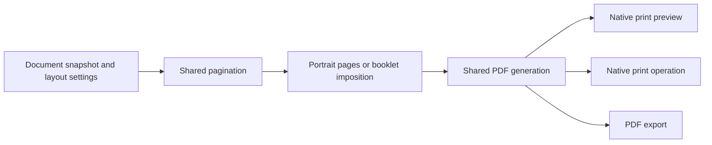

# Pagemark for macOS — implementation plan

Status: the current build is 0.2.12, using the unified repository and shared
core. There is no persistent status bar; search feedback stays in a temporary
Find row. It includes Fit Width and
Resize Window to Fit actions, plus pinch and Command-+/−/0 zoom with remembered
scales in place of the Draft font-size preference, along with
Draft, font-family/appearance preferences, Full Screen, and File > Print Booklet.
It includes shared layout reuse, batched Mac drawing and paragraph-local Unicode indices. The performance changes and module
boundaries are recorded in [PERFORMANCE.md](PERFORMANCE.md); a live typing check
is pending. Both signed runtime/sandbox and native editor probes passed for
0.2.8 on the user's Mac on 2026-11-05, including the revised Command shortcuts,
native Recent-menu routing, the document-open callback, all three views, and
native Preferences controls/appearance checks (`.build/check.xzz5Dg`). The user had already
confirmed that Open Recent opens the listed file correctly in 0.2.6.
All three views and the shared editing session are implemented.
The user also confirmed typing, scrolling, drag-selection and File > Open.
Extended interaction and remaining permission checks are pending validation. See
[README.md](README.md) and [BUILD_STATUS.md](BUILD_STATUS.md) for the current
build and its limits. Architecture remains subject to the prototype gates
below. Based on terminal Pagemark and decisions made on 2026-11-05.

## Agreed product contract

- A close graphical translation of terminal Pagemark, preserving its writing
  constraints and editing commands.
- Primary improvements: mouse/trackpad scrolling, mouse selection, reliable
  keyboard modifiers, and OS-enforced sandboxing.
- Direct interchange with terminal Pagemark's UTF-8 overstrike `.txt` files.
  Preserve text, paragraph boundaries, bold, underline, and their combination.
- Three editable presentations, selected through **View > Continuous**,
  **Pages**, and **Draft**. Draft has a configurable screen font. The View
  menu also offers Light Mode, Dark Mode, System Default and Full Screen.
- All existing printing features: both typewriter fonts, preview, PDF export,
  single/double spacing, duplex, page numbers, and saddle-stitch booklets.
  Reuse shared Pagemark machinery and native Mac dialogs where appropriate.
- **Standard Command shortcuts** for Save/Quit/Find/Print, clipboard,
  Bold/Underline and Undo/Redo. Preserve their Control aliases and remaining
  Emacs commands. Option remains available for native character input.
- Explicit Save with automatic crash recovery; do not autosave into the source
  document.
- Whole-app sandboxing. All documents granted to the app and app-private
  recovery/settings share one trust boundary.
- A native, one-click **File > Open Recent** menu. Launch with a blank document;
  do not automatically reopen the previous session.
- A self-contained downloadable app for a small group, initially targeting
  this Mac. The inspected environment reports **macOS Monterey 12.7.6,
  build 21H1320, x86_64**. Validate that OS/architecture first.

## Document windows and views

Use one window per document, native menus and file panels, and no persistent
status bar. Command-F opens temporary Find controls with their own no-match
feedback; Escape closes them and returns the full window area to the editor.
Native document windows and dialogs handle filenames, save state and errors.
Default new documents to Continuous view; remember the view preference in app settings.

All views edit the same document and use the same command, selection, undo,
and layout state:

| Presentation | Behavior |
| --- | --- |
| Continuous | Fixed-width writing column with page-break markers and smooth scrolling |
| Pages | Editable portrait sheets with margins, spacing, and page numbers matching the document's print layout |
| Draft | Continuous layout with a configurable monospaced screen font, independent of the print font |

Switching views preserves the insertion point, selection, undo history, and a
visible text anchor. It never changes text or inserts page separators.
Resizing and zoom change presentation rather than the document's line width.
Paper gaps and page markers cannot hold a caret or become copied text.

Keep the existing typewriter layouts: Courier at 65 columns, Prestige Elite
at 72 columns, five-column tab stops, hanging indents, and the em-dash display
convention. All views consume shared wrapping and pagination decisions.
Booklet imposition belongs to print preview/output; editing remains in reading
order. A PDF preview is not the editable Pages view.

Pagemark > Preferences configures Draft's installed monospaced family.
Prefer JetBrains Mono NL, falling back to Menlo when unavailable. Font metrics
change screen geometry and mouse hit testing, without changing the shared
fixed-column layout, document bytes, styles or undo. The View menu groups view
modes, appearance choices and Full Screen with separators. Appearance is an
app-wide preference; System Default follows the operating system.

Pinch and Command-+/−/0 zoom the editor from 50–500%; Command-0 means 100%.
The View menu exposes zoom actions. Draft
remembers its own scale; Continuous and Pages share a separate scale. Existing
Draft font sizes migrate to zoom using a 14-point base. Zoom preserves the
visible content anchor, selection, composition and undo, and leaves the print
layout unchanged. Pure zoom policy/anchor math stays separate from Cocoa
gesture dispatch and native scroll positioning.

View > Fit Width adjusts zoom to the existing window; Resize Window to Fit
adjusts width at the current zoom. The latter preserves height, accounts for
scrollbars, respects usable screen bounds and is disabled in full screen.
These are explicit actions, not automatic responses to zooming or resizing.
Natural presentation width comes from shared screen geometry; pure fitting
policy is separate from the native adapter that changes zoom or the window.

Mouse behavior includes click placement, drag selection across wraps/pages,
Shift-click extension, double-click word selection, and drag autoscroll.
Wheel/trackpad scrolling must not relocate the insertion point. Subsequent
editing/navigation reveals the caret as needed. Hit testing uses the shared
mapping between source text and rendered positions.

## Keyboard contract

Use native modifiers without depending on terminal escape sequences or
terminal configuration. The user revised the original Command-as-Meta choice
for these common actions on 2026-11-05:

| Shortcut | Action |
| --- | --- |
| Command-S / Q / F / P | Save / Quit / Find / Print |
| Command-X / C / V | Cut / Copy / Paste |
| Command-B / U | Bold / Underline |
| Command-Z / Y | Undo / Redo; Shift-Command-Z also redoes |
| Command-Left/Right | Move by word; add Shift to extend selection |
| Command-Up/Down | Move by paragraph; add Shift to extend selection |
| Command-D / Command-Backspace | Delete next / previous word |
| Command-T / M / L | Transpose words / Center line / Lowercase word |

The common actions retain their Control aliases in the editor. Control-A/E,
Control-K, Control-T and Control-W retain line start/end, kill line, transpose
characters and word count. Capitalize and Uppercase Word are available under
Edit > Transform, alongside Lowercase Word. Save As uses Shift-Command-S.

`key_bindings.py` owns the editor shortcut policy; native event decoding and
menu dispatch remain separate. Show the primary Command equivalents in menus.
Native dialogs and other text fields use the standard responder chain, and
the document editor only intercepts keys while it has focus. Command-M retains
its existing center-line behavior in that editor.

Use native text composition for inserted text and Option-based character
entry. Account for UTF-16 API ranges, Python codepoint offsets, and composed
characters explicitly. Prototype event routing before implementing the full
editor: AppKit processes key equivalents separately from ordinary key events.
[Apple key-event handling](https://developer.apple.com/library/archive/documentation/Cocoa/Conceptual/EventOverview/HandlingKeyEvents/HandlingKeyEvents.html).

## Shared core and Mac integration

Recommended architecture: **AppKit through PyObjC with a shared Python core**,
conditional on the sandbox and editor prototypes succeeding. This preserves
the existing behavior without duplicating the codec, wrapping, and printing
logic in Swift.

| Existing code | Planned use |
| --- | --- |
| `buffer.py`, `coordinates.py`, `layout.py`, `navigation.py` | Reuse immutable document and layout/navigation contracts |
| `viewport.py` | Reuse relevant content/page-row rules; add pixel geometry for the GUI |
| `model.py`, `commands.py`, `undo.py` | Extract a headless editing session and codec from terminal/editor assumptions |
| `print_formatter.py`, `pdf_generator.py`, `font_config.py`, `booklet.py` | Shared pagination, styled output, font metrics, and booklet imposition |
| Clipboard, settings, save/recovery, and print submission | Platform adapters with document-scoped state |

The existing model still imports clipboard functionality; commands reference
terminal editor/view objects, the codec lives in the model, and settings use
a singleton. Reusing the pure core does not mean embedding the terminal event
loop or assuming those adapters are already suitable for multiple windows.

Keep reusable behavior in the Pagemark package and Mac adapters in this
repository. Use a local dependency during development and a pinned core
release in distributable builds. Separate terminal-only dependencies from
the app's runtime dependency set.

Use `NSDocument` for native document lifecycle and save/close integration.
There must be one authoritative editing session and undo history. If a native
text view participates in editing, integrate it with that authority rather
than maintaining a competing model or undo stack.

Prototype an adapted `NSTextView` and the required layout behavior first.
If exact wrapping and editable pages require custom drawing, use one editor
view with Continuous/Pages/Draft geometry strategies. That route must implement
native text input, accessibility, hit testing, and selection correctly.
[TextKit](https://developer.apple.com/documentation/appkit/textkit),
[NSTextView](https://developer.apple.com/documentation/appkit/nstextview).

## Printing and PDF

Keep a single output pipeline:

Use **File > Print…** for reading-order output and **File > Print Booklet…**
for booklet imposition. Booklet choice belongs to the individual print job,
with no persistent document-format toggle. Both actions use the same shared
PDF machinery and macOS print dialog for printer selection, copies, page
ranges, duplex, cancellation and PDF output. A booklet PDF can be saved through
the print dialog's PDF menu. Keep Export PDF as reading-order output through a
native destination panel. Future Pagemark print accessories concern font and
line spacing.

PDFKit can create an `NSPrintOperation` for a PDF document. Evaluate that as
the simplest adapter. If changing Pagemark options inside the print panel
cannot reliably update PDF/page-count previews through that path, use a thin
printing `NSView` that draws the regenerated PDF pages. Preserve shared
pagination and rendering rather than reimplementing them in the print view.
[PDFKit print operations](https://developer.apple.com/documentation/pdfkit/pdfdocument/printoperation(for:scalingmode:autorotate:)),
[print-panel accessories](https://developer.apple.com/documentation/appkit/nsprintpanelaccessorizing).

A print session takes an immutable text/style snapshot and a copy of the
document's layout settings. Accessory changes regenerate pagination/PDF and
invalidate the native preview. Apply the final settings coherently; canceling
the panel must not leave document settings partially changed. Keep printer
and layout preferences per document.

Preserve Letter-size output, the existing margins, and page numbers starting
on page two. Print at the intended physical scale; screen zoom is independent.
Booklet mode uses the existing padding and imposition, landscape sheets, and
short-edge duplex. Prevent an additional printer-side two-up transformation
or conflicting orientation/scaling. Native page ranges refer to generated
output pages; in booklet mode, label these as sheet sides and default to the
complete booklet. Verify paper handling with a physical
folded booklet. System print settings support duplex selection, but actual
support depends on the printer.
[Core Printing duplex settings](https://developer.apple.com/documentation/applicationservices/1462000-pmsetduplex).

Prefer native print submission to the existing `lpr` subprocess. Validate
printing with the dedicated printing entitlement and without general network
permission, including a configured network printer if one is used.

Courier and regular/bold Prestige Elite files are present on this Mac.
Discover fonts through native APIs and verify sandbox-compatible access for
PDF embedding. If a font resource needs explicit import, use file selection.
Do not silently substitute fonts or grant a whole font directory. Distribution
must account for font availability without assuming user-installed fonts can
be redistributed.

## Saving, recovery, and reopening

Save explicitly through Control-S or the File menu. Track the modified state,
use coordinated atomic replacement of the authorized file, and retain edits
on failure. Verify safe replacement without acquiring access to sibling files.
Close/Quit offers Save, Discard, and Cancel for modified documents.

Keep recovery snapshots inside the app container, including for untitled
documents. Start from the terminal app's ten-second debounce/five-minute
backstop policy, with lifecycle-triggered flushes where appropriate. Recovery
does not overwrite the source file or clear the modified indicator. Use one
recovery owner integrated with `NSDocument`; do not run independent competing
autosave mechanisms.
[NSDocument autosave behavior](https://developer.apple.com/documentation/appkit/nsdocument/autosavesinplace).

After a crash, offer recovery explicitly. Recovered text can be inspected
without automatically reopening or overwriting its original file. Reauthorize
the original destination when necessary. A successful save or explicit
discard clears the corresponding recovery state. Crash recovery is distinct
from reopening all prior document windows on normal launch.

Use native **File > Open Recent**, with **Clear Menu**, plus ordinary Open and
Finder integration. A recent-item click should open the document directly.
Apple documents that selecting an item from Open Recent expands sandbox
access to that item.
[User-selected file access](https://developer.apple.com/library/archive/documentation/Miscellaneous/Reference/EntitlementKeyReference/Chapters/EnablingAppSandbox.html).

The accepted workflow does not itself prove permission revocation. Test a
fresh launch before any file-opening action to determine whether native
recent-document integration, restoration data, or bookmarks retain reusable
authorization. Account separately for recovery copies in the private
container. If one-click recents conflict with fresh authorization, present
the concrete tradeoff before changing either behavior. Closing a window or
clearing a menu is not a proven security revocation.

## Security boundary

Use **macOS App Sandbox**, enforced by the OS for the running app and its
dependencies. Python path checks or disabled networking modules cannot
constrain arbitrary malicious dependency code. Whole-app isolation is
selected; per-document worker isolation is outside v1.

| Capability | Policy |
| --- | --- |
| Sandbox | Enable `com.apple.security.app-sandbox` |
| User documents | Enable user-selected read/write access; open individual files |
| Direct network | Omit both client and server network entitlements |
| Broad folders | No Downloads/media/all-files grants or temporary file exceptions |
| Settings/recovery | Store in the app-private container |
| Printing | Dedicated printing entitlement; verify native service operation |
| Updates | Manual download outside the running app |

This boundary still exposes every granted document, in-memory document, and
private recovery/settings file to dependencies in the app. It also permits
necessary system/runtime resources. It does not literally allow only one
filesystem object.
[App Sandbox](https://developer.apple.com/documentation/security/app-sandbox),
[implicit system access](https://developer.apple.com/library/archive/qa/qa1773/_index.html).

Denying direct network connections is narrower than proving that malicious
code cannot exfiltrate data. Evaluate DNS and system-mediated routes such as
URL opening, interprocess services, clipboard, and printing. Record residual
capabilities and compare them with the user's threat model. Do not silently
weaken requirements to make a dependency work.

Bundle the runtime and dependencies. Exclude user-site packages, environment
search paths, plugins, and runtime package installation. GUI settings belong
in its container; any import from terminal settings requires explicit action.
No adjacent swap files, home-directory scans, or blanket parent-folder grants.

Verify signed entitlements on every shipped executable/helper. Hardened
runtime, signing, and notarization complement sandboxing. PyObjC documents
runtime entitlement requirements that must be tested with this configuration.
[PyObjC signing guidance](https://pyobjc.readthedocs.io/en/latest/notes/codesigning.html).

Dependency installation/builds also need isolation from personal documents
and signing credentials: the runtime sandbox does not protect an unsandboxed
build process. Keep signing and network-dependent release tooling separate
from the running app.

## Packaging and target environment

First acceptance target: the reported macOS 12.7.6/x86_64 environment. Avoid
requiring newer APIs, an OS upgrade, or a separately installed Python. Broader
OS/architecture support can be added later without changing the file format.

The source environment currently has Python 3.12.2, PyObjC/Cocoa 12.1, and
ReportLab 4.4.9. Use these as a starting compatibility baseline, not an
unexamined release lock. PDFKit/printing bridges will add the required
framework wrappers; the existing environment does not have the Quartz wrapper.

Evaluate py2app for a standalone bundle early. The available developer tools
are Command Line Tools; do not assume full Xcode is installed. Produce a
signed, notarized downloadable app and verify it launches without the sibling
checkout or development environment. Manual downloads handle initial updates.
[py2app deployment](https://py2app.readthedocs.io/en/latest/tutorial.html#building-for-deployment).

## Implementation milestones and completion gates

1. **Packaged sandbox prototype.** Launch a minimal app with the proposed
   runtime on this Mac. Verify authorized open/save, denied unrelated-file and
   direct-network operations, recent-file authorization, font access, and a
   native print operation. Run hostile fixture code inside the signed bundle,
   not only inside a test runner. Resolve failures without broad permissions.
2. **Shared editing session and compatibility.** Extract the codec/command
   boundary and per-document settings while keeping terminal behavior covered.
   Define Unicode coordinate conversion and shared layout/output fixtures.
3. **Editor prototype in both views.** Validate native shortcut routing,
   native composition, wraps, hit testing, page gaps, drag autoscroll, scrolling,
   selection, and undo. Decide native-text/custom-view implementation using
   these cases. A read-only PDF page display does not satisfy this gate.
4. **Complete document workflow.** New/Open/Recent, editing and formatting,
   search, clipboard, explicit Save/Save As, independent document windows,
   recovery, failed-save handling, and external file-change detection.
5. **Native printing with full feature parity.** Shared PDF pipeline, native
   controls and preview, both fonts/spacings, ordinary duplex, and booklets.
   Verify PDF export and physical output agree with the selected settings.
6. **Release validation.** Keyboard-only and mouse use, accessibility, real
   writing sessions, sandbox regression tests, signed bundle verification,
   and clean installation on the target environment.

Version 0.2.2 passed the sandbox runtime and hidden native editor probes,
including Command/Control routing, undo/redo and view-state preservation.
The user confirmed basic typing, scrolling and drag-selection. The remaining
interaction and document-workflow checks are in [EDITOR_CHECK.md](EDITOR_CHECK.md).

## Acceptance cases and unresolved engineering issues

- Cross-application text/style round trips, including empty/trailing
  paragraphs, malformed legacy input, newline/encoding handling, and unusual
  styled characters. Define semantic compatibility separately from preserving
  original bytes on an unchanged file.
- The existing codec has a confirmed ambiguity: bold underscore serializes
  as `_\b_`, which the current parser reads as underline. A read-only
  reproduction changed style 1 to style 2. Resolve the compatibility contract
  in the shared core; a GUI-only reinterpretation cannot provide lossless
  interchange with the old terminal reader for that ambiguous representation.
- Layout fixtures cover tabs, hanging indents, em dashes, exact wrap
  boundaries, composed characters, empty paragraphs, both fonts, and spacing.
- View switching preserves text, selection, caret, undo, and visible context.
  Page markers and gaps never enter the document or selection contents.
- Native typing and undo preserve composed/marked text and style ranges.
  Command/Control/Option handling works without terminal configuration.
- Preview/PDF/physical output agree; booklet padding, page order, scale,
  orientation, duplex binding, and printer-side layout combinations are tested.
- Save failure retains edits; crash recovery covers named and untitled
  documents; external changes cannot be silently overwritten.
- Sandbox fixture tests cover unauthorized sibling/unrelated files, direct
  connections/listeners, helpers, native print/PDF export, and authorization
  after relaunch. OS-mediated egress and retained recovery data need explicit
  treatment before making stronger confidentiality claims.
- Determine a representative long-document performance budget during the
  editor prototype; avoid full-document relayout on each keystroke.

The remaining questions are primarily prototype results: sandbox enforcement
and permission lifetime, editable page layout, live native print-preview
updates, font embedding, and the legacy codec ambiguity. Implementation has
progressed to the editable-view prototype. The tested direct sandbox denials
and native editor probes passed; broader permission lifetime and live editor
validation remain open.
